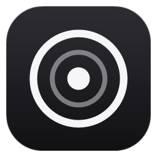
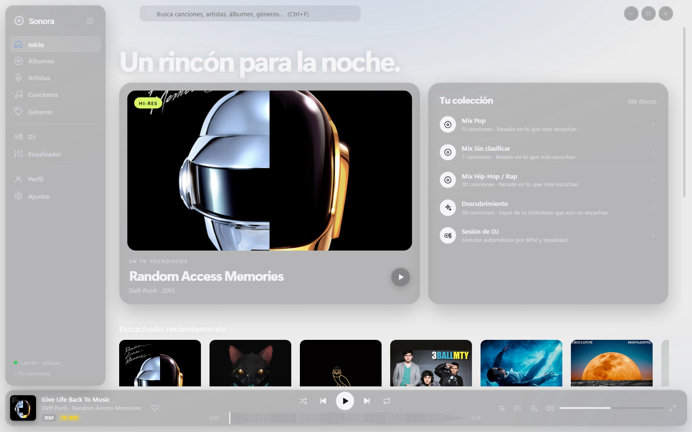
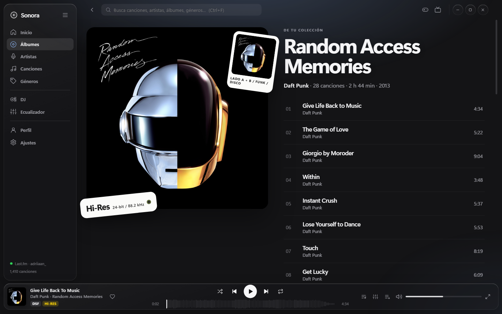
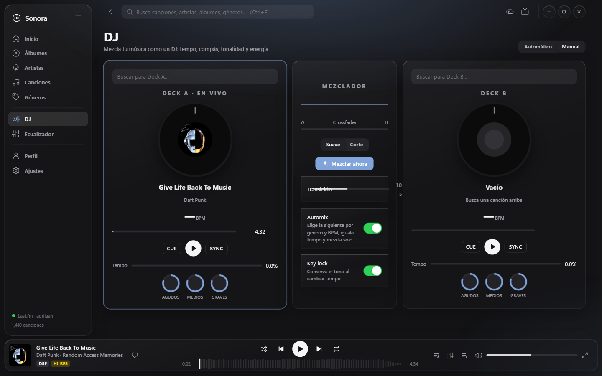
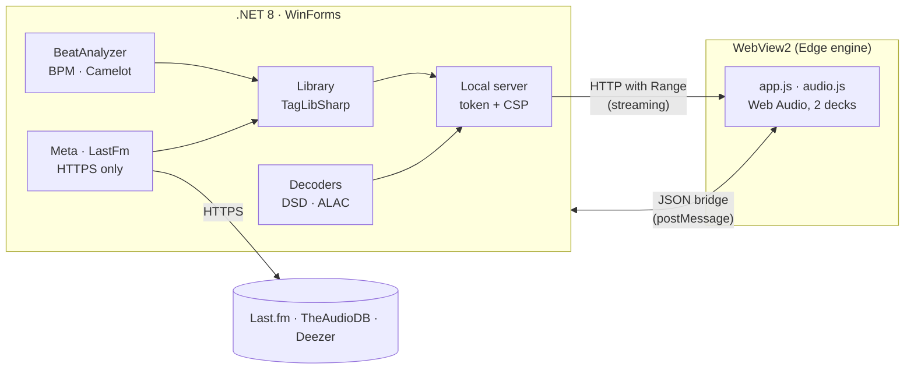

<div align="center">



# Sonora

**A lightweight Hi-Res music player for Windows, built to run alongside your games**

FLAC · DSD · ALAC · Auto DJ with BPM and key detection · 10-band EQ · Last.fm

[](https://github.com/adriandiazserna/Sonora/actions/workflows/build.yml)


[Español](README.md) · **English**



</div>

## Download

Get the latest version from [**Releases**](https://github.com/adriandiazserna/Sonora/releases/latest). Unzip `Sonora-x.y.z-win-x64.zip` (or `win-x86` for 32-bit Windows) and run `Sonora.exe`; nothing else to install.

## Why I built it

I listen to FLAC and DSD on the same laptop I game on. Every player I tried was either too heavy (Electron apps sit around 400–700 MB) or couldn't play DSD. Sonora started with one measurable goal: **play high-resolution audio without taking memory away from the game**.

| | Before optimizing | Now |
|---|---|---|
| Total RAM while playing | 686 MB | **≈ 238 MB** |
| RAM when minimized | — | **≈ 207 MB** |
| CPU with the visualizer open | ≈ 135 % of one core | **≈ 24 %** |

*Measured on an HP Victus laptop with a 1,410-track library (window visible).*

## Highlights

- **Custom DSD decoder** (`src/Decoders.cs`): converts DSF to 88.2 kHz / 24-bit PCM with a Kaiser FIR filter and per-byte lookup tables, no ffmpeg needed. Runs at 53× real time on DSD128 (≈ 2 % of one core) and matches ffmpeg with a 0.9996 correlation.
- **Auto DJ**: analyzes every track (BPM, beat grid, Camelot key, energy curve and waveform) and mixes on its own. It beat-matches with a phase-locked loop (±5 ms measured error), swaps the bass between decks and follows your taste. Just ask in plain text: *«DJ reggaetón»*, *«fiesta 100 BPM»*.
- **Two-deck audio engine** built on Web Audio: equal-power crossfade, gapless playback, ReplayGain, limiter, and a 10-band parametric EQ with automatic presets by genre.
- **Automatic genres**: weighs tags from the file, Last.fm and TheAudioDB to sort music into 21 genres with a confidence level.
- **Local recommendations**: learns from what you finish, skip and replay (with time decay), without sending your data anywhere.
- **Game mode and TV mode**: media keys work in-game, and TV mode is a 10-foot interface you can drive with a controller.

<table>
<tr>
<td></td>
<td></td>
</tr>
<tr>
<td align="center"><sub>Editorial-style album view</sub></td>
<td align="center"><sub>Two-deck DJ with automix</sub></td>
</tr>
</table>

## Architecture



**Key decisions to save memory**

- **WebView2 instead of Electron**: reuses the Edge engine already on Windows instead of shipping its own Chromium.
- **Software rendering by default**: saves about 250 MB and leaves the GPU free for the game.
- **No expensive CSS filters** (`backdrop-filter`, `blur`): they pushed the GPU process up to 500 MB. Backgrounds are blurred once on a 48 px canvas.
- **Streaming with HTTP ranges**: FLAC files are never fully loaded into RAM, and long lists are virtualized.
- **When minimized**: the UI stops rendering, WebView2 switches to `MemoryUsageTargetLevel.Low` and the working set is trimmed.

## Security

Sonora is single-user and has no backend, but it does run a local server and handle credentials, so I treated it like any other attack surface. Summary below; the full threat model is in [SECURITY.md](SECURITY.md) (Spanish).

- **Authenticated local server**: a random 256-bit token per session in an `HttpOnly` + `SameSite=Strict` cookie, `Sec-Fetch-Site` and `Host` checks (against DNS rebinding), and `GET`/`HEAD` only.
- **Encrypted credentials** with Windows DPAPI. Sonora never sees your Last.fm password; it uses the official browser authorization flow.
- **HTTPS enforced** on all outgoing traffic, with SSRF protection that checks IPs after DNS resolution.
- **Strict Content Security Policy**, `nosniff`, `X-Frame-Options`, CORP, and all browser permissions denied.
- **No keys in the repository**: each user brings their own Last.fm API key.

## Build and run

Requirements: Windows 10 or 11, 64-bit or 32-bit (the glass effect needs Windows 11 22H2 or later; older versions get a solid background), [.NET 8 SDK](https://dotnet.microsoft.com/download/dotnet/8.0) and the WebView2 Runtime (included in Windows 11).

```powershell
winget install Microsoft.DotNet.SDK.8                     # one time only
powershell -ExecutionPolicy Bypass -File build.ps1 -Dev   # dev mode (reload the UI with F5)
powershell -ExecutionPolicy Bypass -File build.ps1        # release build in .\dist + desktop shortcut
```

### Connect Last.fm (optional)

1. Create a free API account at <https://www.last.fm/api/account/create>.
2. In **Ajustes → Last.fm** (Settings), paste the *API key* and *shared secret* and click **Guardar** (Save). They're stored encrypted.
3. Click **Conectar** (Connect), authorize in your browser, then click **Ya autoricé** (I've authorized).

> The interface is currently in Spanish.

## Project structure

```
src/            .NET core: server, bridge, library, decoders, BPM analysis, Last.fm, security
ui/             HTML/CSS/JS interface, no frameworks or dependencies
  js/audio.js   two-deck engine, EQ, limiter, analyzer
  js/dj.js      Auto DJ (picks by BPM, key and energy; phase sync)
assets/         icon
tools/          icon generator script
```

## Known limitations

- Output goes through shared-mode WASAPI, with no exclusive or bit-perfect mode. To avoid resampling, match the engine's sample rate to your DAC in **Ajustes → Audio**.
- DFF, APE and WMA files show up in the library but need converting to FLAC (the app does it with ffmpeg if installed).
- Windows 10 and 11 only for now. There is no macOS or Linux version.

## License

[MIT](LICENSE) © 2026 Adrián Díaz Serna
