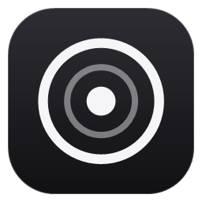
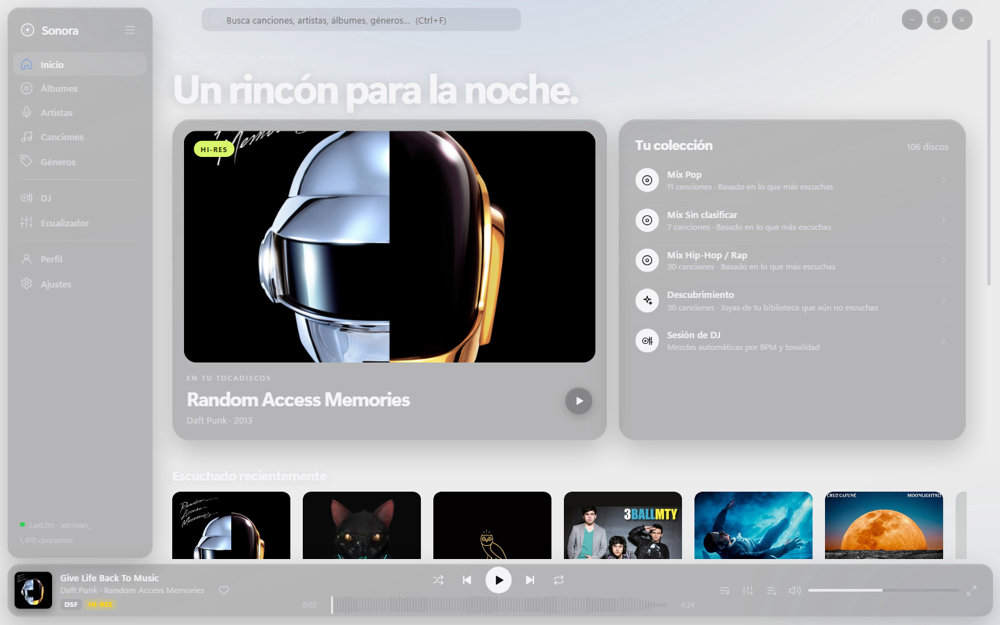
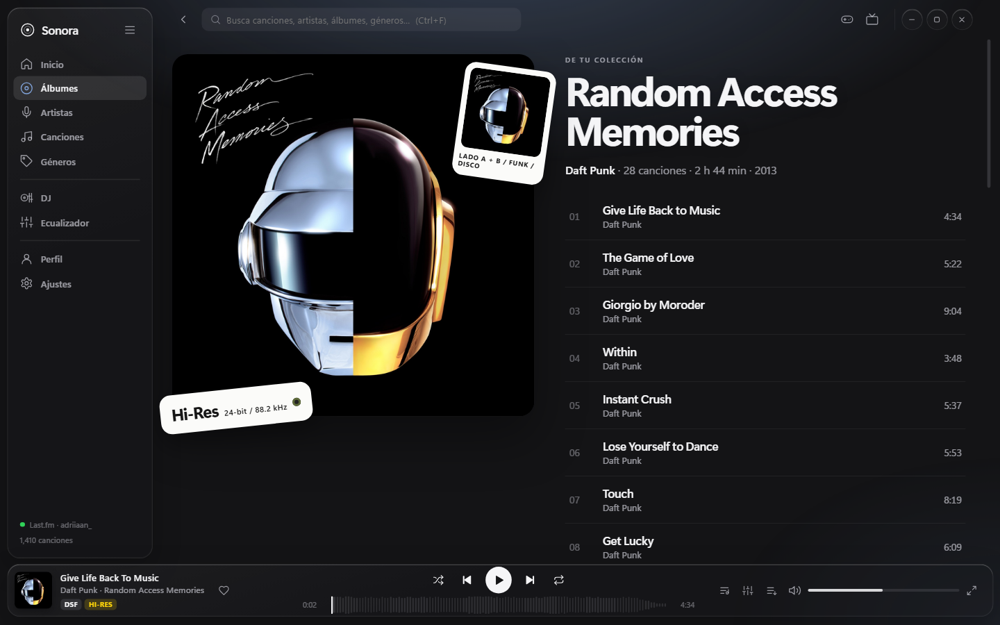
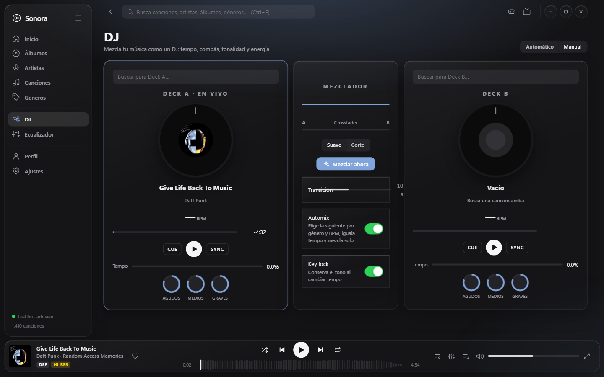
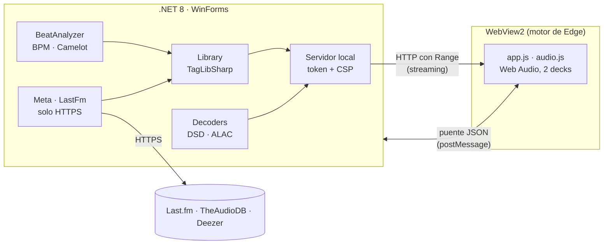

<div align="center">



# Sonora

**Reproductor de música Hi-Res para Windows que gasta poca RAM para poder jugar al mismo tiempo**

FLAC · DSD · ALAC · Auto DJ con detección de BPM y tonalidad · Ecualizador de 10 bandas · Last.fm

[](https://github.com/adriandiazserna/Sonora./actions/workflows/build.yml)




</div>

## Por qué lo hice

Escucho música en FLAC y DSD en la misma laptop con la que juego. Los reproductores que probé o pesaban demasiado (las apps de Electron rondan los 400–700 MB) o no reproducían DSD. Sonora nació con una meta medible: **sonar en alta resolución sin quitarle memoria al juego**.

| | Antes de optimizar | Ahora |
|---|---|---|
| RAM total sonando | 686 MB | **≈ 238 MB** |
| RAM minimizada | — | **≈ 207 MB** |
| CPU con el visualizador abierto | ≈ 135 % de un núcleo | **≈ 24 %** |

*Medido en una laptop HP Victus con una biblioteca de 1 410 pistas (con la ventana visible).*

## Funciones destacadas

- **Decodificador DSD propio** (`src/Decoders.cs`): pasa de DSF a PCM de 88.2 kHz/24 bits con un filtro FIR Kaiser y tablas por byte, sin ffmpeg. Corre a 53× tiempo real en DSD128 (≈ 2 % de un núcleo), y lo comprobé contra ffmpeg con una correlación de 0.9996.
- **Auto DJ**: analiza cada canción (BPM, rejilla de compás, tonalidad en notación Camelot, curva de energía y forma de onda) y mezcla sola. Iguala el tempo con un lazo de fase (error medido de ±5 ms), cruza los bajos y respeta tus gustos. Se le pide por texto: *«DJ reggaetón»*, *«fiesta 100 BPM»*.
- **Motor de audio de dos decks** en Web Audio: crossfade de potencia constante, reproducción sin pausas, ReplayGain, limitador y ecualizador paramétrico de 10 bandas con EQ automático por género.
- **Géneros automáticos**: combina las etiquetas del archivo, de Last.fm y de TheAudioDB, con pesos, para clasificar en 21 géneros con nivel de confianza.
- **Recomendaciones locales**: aprende de lo que completas, saltas y repites (con decaimiento temporal), sin mandar tus datos a ningún servidor.
- **Modo juego y modo TV**: las teclas multimedia funcionan dentro del juego; el modo TV es una interfaz de 10 pies que se maneja con mando.

<table>
<tr>
<td></td>
<td></td>
</tr>
<tr>
<td align="center"><sub>Vista de álbum de estilo editorial</sub></td>
<td align="center"><sub>DJ con dos decks y automix</sub></td>
</tr>
</table>

## Arquitectura



**Decisiones clave para ahorrar memoria**

- **WebView2 en lugar de Electron**: usa el motor de Edge que Windows ya tiene, así que no carga un Chromium propio.
- **Dibujo por software por defecto**: ahorra unos 250 MB y deja la GPU libre para el juego.
- **Nada de filtros CSS costosos** (`backdrop-filter`, `blur`): inflaban el proceso de GPU hasta 500 MB. Los fondos se desenfocan una sola vez en un canvas de 48 px.
- **Streaming con rangos HTTP**: los FLAC nunca se cargan completos en RAM, y las listas largas son virtuales.
- **Al minimizar**: la interfaz deja de dibujarse, WebView2 pasa a `MemoryUsageTargetLevel.Low` y se recorta la memoria de trabajo.

## Seguridad

Sonora es de un solo usuario y no tiene backend, pero sí abre un servidor local y usa credenciales, así que lo traté como cualquier superficie de ataque. Resumen (el modelo de amenazas completo está en [SECURITY.md](SECURITY.md)):

- **Servidor local con autenticación**: un token aleatorio de 256 bits por sesión en una cookie `HttpOnly` + `SameSite=Strict`, comprobación de `Sec-Fetch-Site` y de `Host` (contra DNS rebinding), y solo `GET`/`HEAD`.
- **Credenciales cifradas** con DPAPI de Windows. Sonora nunca ve tu contraseña de Last.fm: usa el flujo oficial de autorización en el navegador.
- **HTTPS forzado** en todo el tráfico saliente, con protección contra SSRF que revisa las IPs ya resueltas por DNS.
- **Content Security Policy** estricta, `nosniff`, `X-Frame-Options`, CORP y permisos del navegador denegados.
- **Sin claves en el repositorio**: cada usuario pone su propia API key de Last.fm.

## Compilar y ejecutar

Requisitos: Windows 10/11, [.NET 8 SDK](https://dotnet.microsoft.com/download/dotnet/8.0) y WebView2 Runtime (viene con Windows 11).

```powershell
winget install Microsoft.DotNet.SDK.8                     # una sola vez
powershell -ExecutionPolicy Bypass -File build.ps1 -Dev   # modo desarrollo (la UI se recarga con F5)
powershell -ExecutionPolicy Bypass -File build.ps1        # versión final en .\dist + acceso directo
```

### Conectar Last.fm (opcional)

1. Crea una API account gratuita en <https://www.last.fm/api/account/create>.
2. En **Ajustes → Last.fm**, pega la *API key* y el *shared secret* y pulsa **Guardar** (se guardan cifrados).
3. Pulsa **Conectar**, autoriza en el navegador y vuelve a pulsar **Ya autoricé**.

## Estructura

```
src/            núcleo .NET: servidor, puente, biblioteca, decodificadores, análisis de BPM, Last.fm, seguridad
ui/             interfaz HTML/CSS/JS sin frameworks ni dependencias
  js/audio.js   motor de dos decks, EQ, limitador, analizador
  js/dj.js      Auto DJ (selección por BPM, tono y energía; sincronía de fase)
assets/         ícono
tools/          script que genera el ícono
```

## Limitaciones conocidas

- Salida por WASAPI compartido, sin modo exclusivo ni bit-perfect. Para evitar el remuestreo, iguala en **Ajustes → Audio** la frecuencia del motor con la de tu DAC.
- DFF, APE y WMA aparecen en la biblioteca, pero hay que convertirlos a FLAC (la app lo hace con ffmpeg si está instalado).
- Por ahora solo funciona en Windows.

## Licencia

[MIT](LICENSE) © 2026 Adrián Díaz Serna
